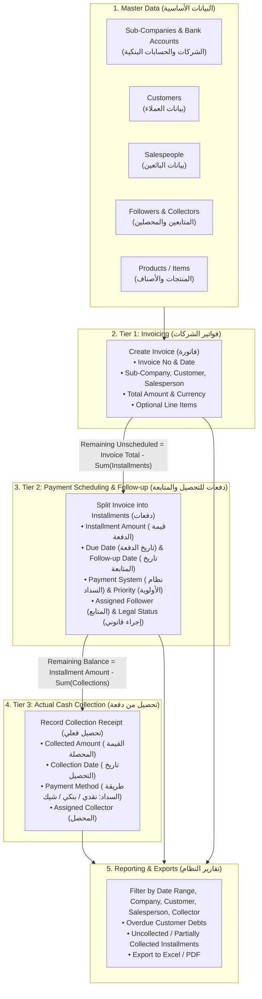
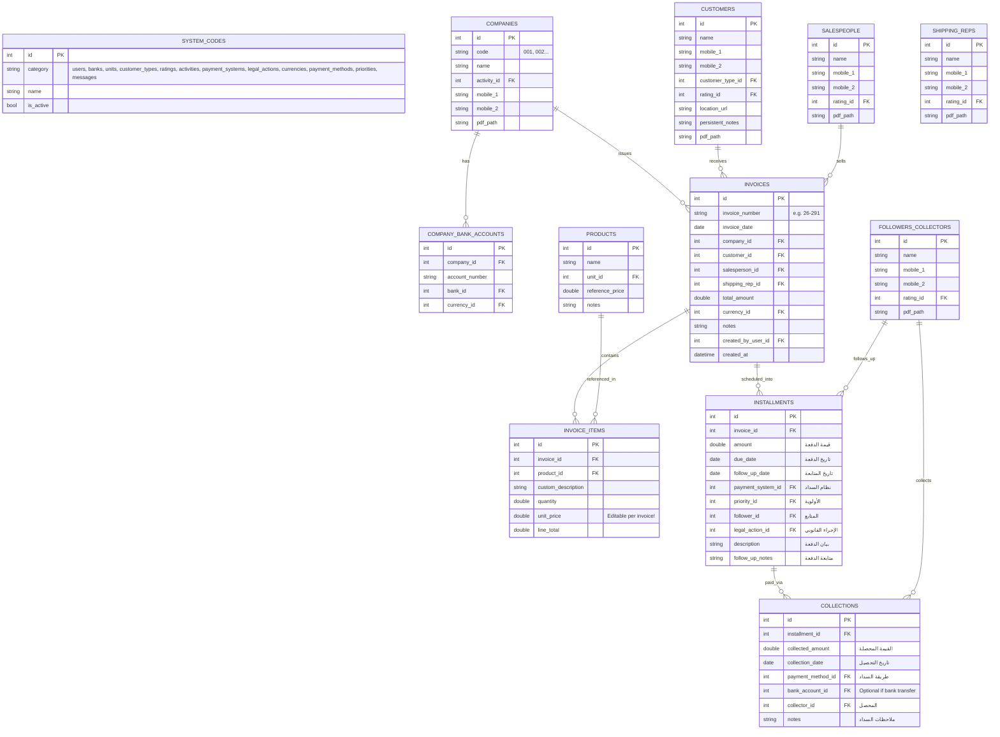

# System Documentation: Shipping, Distribution & Collections Management System
**(نظام إدارة الشحن والتوزيع والتحصيلات)**

---

## 1. Executive Summary & What the Business Actually Does

Although described casually as a warehouse/distribution system, the screenshots show a legacy Microsoft Access desktop application titled **«نظام إدارة الشحن والتوزيع والتحصيلات»** (*Shipping, Distribution, and Collections Management System*), built for **Kanza Group** (an agricultural/chemical & project development group operating multiple sub-companies).

> [!IMPORTANT]
> **Core Business Purpose:**
> The heart of this system is **Multi-Company Sales Invoicing, Installment Scheduling (جدولة الدفعات), Debt Follow-up (المتابعة), and Cash/Bank Collection Tracking (التحصيلات)** rather than physical bin/shelf warehouse inventory.
>
> Your friend's daily workflow revolves around:
> 1. Issuing or recording **Invoices (`فواتير الشركات`)** under specific sub-companies for **Customers (`العملاء`)** sold by **Salespeople (`البائعين`)**.
> 2. Breaking each invoice into **Scheduled Installments (`دفعات للتحصيل والمتابعة`)** with due dates, follow-up dates, priorities, and assigned follow-up agents.
> 3. Recording **Actual Money Collected (`تحصيل من دفعة`)** (full or partial payments) against each scheduled installment, tracking who collected it and how it was paid.
> 4. Generating filtered **Reports (`تقارير النظام`)** on overdue debts, uncollected/partially collected installments, salesperson performance, and collector activity.

---

## 2. Core Business Workflow (The 3-Tier Financial Lifecycle)

Understanding the difference between ** الفاتورة (Invoice)**, **الدفعة (Scheduled Installment)**, and **التحصيل (Actual Collection)** is the key to the entire system:



### Key Financial Formulas in the System
1. **At the Invoice Level (`الفاتورة`):**
   $$\text{Unscheduled Invoice Value (قيمة بدون دفعة)} = \text{Invoice Total (قيمة الفاتورة)} - \sum \text{Scheduled Installments (إجمالي الدفعات)}$$
2. **At the Installment Level (`الدفعة`):**
   $$\text{Remaining for Follow-up (الباقي للمتابعة)} = \text{Installment Amount (قيمة الدفعة)} - \sum \text{Collected Amounts (المسدد منها / القيمة المحصلة)}$$
3. **At the Customer / Sector Level (`مديونية قطاع / موقف فواتير عميل`):**
   $$\text{Total Customer Debt} = \sum \text{Customer Invoices} - \sum \text{Total Collected Across All Invoices}$$

---

## 3. Screen-by-Screen Breakdown

````carousel

<!-- slide -->

<!-- slide -->

<!-- slide -->

<!-- slide -->

<!-- slide -->

<!-- slide -->

<!-- slide -->

<!-- slide -->

<!-- slide -->

<!-- slide -->

<!-- slide -->

````

---

### 3.1 Main Screen & Navigation (`الشاشة الرئيسية`)
* **Friend's Note:** *"دا السيستم اول لما يفتح"* (This is the system when it first opens).
* **Session Info (Bottom-Left & Top Bar):** Displays Current Logged-in User ID & Name (`002 - محمد أسعد`), Day of Week (`الأحد`), and Current Date (`08/11/2026`).
* **Right-Hand Navigation Menu:**
  1. **أكواد النظام** (System Lookup Codes — Red/Green button)
  2. **بيانات الشركات** (Sub-Companies Master Data)
  3. **الحسابات البنكية للشركات** (Company Bank Accounts)
  4. **بيانات العملاء** (Customers Master Data)
  5. **بيانات البائعين** (Salespeople Master Data)
  6. **مندوبين الشحن** (Shipping Representatives / Drivers)
  7. **المتابعين والمحصلين** (Follow-up & Collection Agents)
  8. **المنتجات والأصناف** (Products & Items)
  9. **فواتير الشركات** (Company Invoices — Blue highlight, primary operational screen)
  10. **دفعات للتحصيل والمتابعة** (Installments for Collection & Follow-up — Blue highlight)
  11. **تقارير النظام** (System Reports — Yellow highlight)
* **System Utilities (Bottom-Right & Bottom-Left):**
  * `تغيير المستخدم` (Switch User)
  * `Folder_For_Excel` (Open/Configure Export Folder for Excel files)
  * `LogViewer` (Audit log of user actions)
  * `Minimize` / `إنهاء النظام` (Exit System)

---

### 3.2 System Lookup Codes (`أكواد النظام`)
* **Friend's Note:** *"دي اكواد هو حاطط فيها كل الداتا اللي قدامك دي"* (These are lookup codes where he stores all the dropdown categories shown here).
* **Purpose:** A dynamic dictionary/lookup manager so the admin can add or edit dropdown options across the app without changing code.
* **Lookup Categories Listed:**
  1. `مستخدمي النظام` (System Users)
  2. `اسماء البنوك` (Bank Names — e.g., بنك مصر)
  3. `وحدات المنتجات` (Product Units — e.g., kg, roll, liter, ton)
  4. `انواع العملاء` (Customer Types — e.g., nursery/مشتل, farm/مزرعة, trading company/شركة تجارية, project/مشروع)
  5. `تقييم المتعاملين` (Ratings/Grades for Customers, Salespeople, Collectors — e.g., A, B, C, VIP, ملتزم)
  6. `انشطة الشركات` (Company Business Activities — e.g., pesticides & chemicals, project development)
  7. `انظمة السداد` (Payment Terms/Systems — e.g., cash, 30-day credit, installment plan, post-dated check)
  8. `الاجراءات القانونية` (Legal Actions — e.g., بدون, إنذار, محضر, شيك بدون رصيد, قضية)
  9. `العملات المستخدمة` (Currencies — e.g., جنيه مصري, دولار)
  10. `طريقة السداد` (Payment Methods — e.g., نقدي, تحويل بنكي, شيك, فودافون كاش / انستاباي)
  11. `الاولويات` (Priorities — e.g., مشروعات, عاجل, عادي, بدون)
  12. `رسائل متابعة النظام` (Canned Follow-up Messages/Templates)

---

### 3.3 Sub-Companies (`بيانات الشركات`) & Bank Accounts (`الحسابات البنكية للشركات`)
* **Friend's Notes:**
  * *"و دا هو بيقولي ان لو احنا عندنا في كذا نوع شركة في شركة واحده مقسمهم علشان كل تحصيل او كل فاتوره يختارها و تتسجل عليها التحصيل او الدفعة او الفاتوره"* (If our parent group operates multiple sub-companies/divisions, they are separated here so every invoice, installment, and collection is tagged to the specific sub-company).
  * *"دا احنا عندنا شركتيين شغاليين عليهم و كذا حساب بنك بس هو حاطط حسابيين بس"* (We have two active companies we work on and multiple bank accounts, though only two are currently entered).
* **Sub-Companies Fields (`بيانات الشركات`):**
  * `كود الشركة` (Auto/Manual ID: `001`, `002`, `003`)
  * `اسم الشركة` (Company Name — e.g., *كانزا جروب لتنمية المشروعات والخدمات*, *كانزا جروب للمبيدات والكيماويات*, *AAK*)
  * `النشاط` (Activity dropdown from System Codes)
  * `موبايل 1`, `موبايل 2` (Phone numbers)
  * `بي دي اف` (Attached PDF document / commercial register)
  * **Actions:** Add (`إضافة`), Save New (`حفظ الإضافة`), Save Edit (`حفظ التعديل`), Delete (`حذف`), Attach/View PDF (`PDF`), Open Bank Accounts Screen (`شاشة الحسابات البنكية`), Show/Hide Company Bank Accounts inline (`إظهار / إخفاء الحسابات البنكية للشركة`), Export (`To_Excel`), Search by Company Name or Activity.
* **Company Bank Accounts Fields (`الحسابات البنكية للشركات`):**
  * `رقم الحساب` (Account Number — e.g., `155/1/78399`, `155/1/47431`)
  * `الشركة` (Linked Sub-Company dropdown)
  * `البنك` (Bank Name dropdown — e.g., `بنك مصر`)
  * `العملة` (Currency dropdown — e.g., `جنيه مصري`)
  * **Actions:** Standard CRUD + `To_Excel` + Search by Account/Company or Bank/Currency.

---

### 3.4 Customers (`بيانات العملاء`)
* **Friend's Note:** *"دا بنسجل فيها بيانات العملاء الجديده"* (Here we register new customers' data; notice there are **2,572 customers** in the table!).
* **Fields:**
  * `اسم العميل` (Customer Name — farms, nurseries, companies, individuals)
  * `موبايل 1`, `موبايل 2` (Mobile 1 & Mobile 2)
  * `نوع العميل` (Customer Type dropdown)
  * `تقييم العميل` (Customer Rating dropdown)
  * `موقع العميل` (Customer Location — URL/Google Maps link or address text, with a top button `موقع العميل` to open it)
  * `بي دي اف` (Customer file/document attachment)
* **Search & Actions:**
  * Search by `العميل - موبايل` (Customer Name or Mobile) and `النوع - التقييم` (Type or Rating).
  * Standard CRUD (`إضافة`, `حفظ الإضافة`, `حفظ التعديل`, `حذف`), `PDF`, `موقع العميل`, `To_Excel`.

---

### 3.5 Salespeople (`بيانات البائعين`) & Collectors/Followers (`بيانات المتابعين والمحصلين`)
* **Friend's Notes:**
  * **Salespeople:** *"و دول البياعين اللي عندنا و بنسجل فيها اي بياع يجي جديد"* (These are our salespeople—46 registered—where we add any new salesperson. Note that `"مكتب"` (Office) is also used as a salesperson entry for direct office sales).
  * **Followers/Collectors:** *"و دول الناس اللي بتتابع العميل او بتحصل منه علشان يكتب مين اللي حصل و تابع علشان بعد كدا بنطلع الريبورتات لينا"* (These are the staff who follow up with the customer or collect money from them, so we record who followed up and who collected for our reports).
* **Fields (identical structure for both screens):**
  * `اسم البائع` / `اسم المتابع-المحصل` (Name)
  * `موبايل 1`, `موبايل 2` (Mobile 1 & 2)
  * `تقييم البائع` / `التقييم` (Rating dropdown)
  * `بي دي اف` (PDF attachment)
* **Note on Shipping Reps (`مندوبين الشحن`):** Appears on the main menu right between Salespeople and Collectors, following the exact same contact structure for delivery/shipping personnel.

---

### 3.6 Products & Items (`المنتجات والأصناف`)
* **Friend's Note:** *"دا كان عايز يسجل الاصناف بس منفعش علشان عندنا الاسعار مش سابته كان عايز يكتب الصنف اللي اتباع يبان في على طول بكام"* (He wanted to register products here, but it didn't work out well in the old app because our prices aren't fixed—he wanted to pick the product sold and have its default price appear, while being able to change the price freely on the invoice).
* **Fields Shown:**
  * `اسم المنتج` (Product Name — e.g., `بلادين 200 كجم`, `رول بلاستيك`)
  * `س استرشادى` (Reference / Guiding Price — e.g., `70000`, `20000`)
* **Design Takeaway for Our Flutter App:**
  > [!TIP]
  > In our new Flutter app, we should make `سعر استرشادي` (Guiding Price) auto-fill when selecting a product in an invoice, **but keep the Unit Price (`سعر الوحدة`) and Total editable on the invoice line item** (and even allow creating an invoice with just a total lump-sum amount if they don't want to enter line items!).

---

### 3.7 Company Invoices (`فواتير الشركات`) — *Primary Operational Screen*
* **Friend's Note:** *"و دي تقريبا اهم واجهه انا شغال عليها تقريبا فيها كل حاجه و بسجل فيها الفواتير الجديده و ال بحصل الفلوس منها و بدخل على الفواتير منها و بسجل جواها الدفعات و كده"* (This is practically the most important screen I work on—it has almost everything. I register new invoices here, navigate into invoices to schedule installments and record collections, etc. Currently holds **2,787 invoices**).
* **Form Fields:**
  * `الشركة` (Sub-Company dropdown)
  * `العميل` (Customer dropdown + `??? العميل` quick search/filter helper)
  * `موبايل 1`, `موبايل 2` (Displayed/editable customer mobile numbers with `تحديث-موبايلات` button to update customer record directly from the invoice screen!)
  * `البائع` (Salesperson dropdown + `??? البائع` helper)
  * `رقم الفاتورة` (Invoice Number — string/code like `26-291`, `26-264-1`, `26-258-259`)
  * `ت الفاتورة` (Invoice Date — e.g., `29/11/2026`)
  * `قيمة الفاتورة` (Invoice Total Amount — e.g., `7000`, `114000`, `20468360`)
  * `العملة` (Currency dropdown — defaults to `جنيه مصرى`)
  * `ملاحظات` (Invoice Notes — bottom wide text box)
  * `ملاحظات العميل` (Customer-level persistent notes — top-right peach box with `تحديث ملاحظات العميل` button)
* **Special Action Buttons on Invoices Screen:**
  * **`اضافة المنتجات للفاتورة` (Blue button):** Attach product line items (Product, Qty, Unit, Price) to the invoice.
  * **`موقف فواتير عميل` (Blue button):** View full statement/summary of all invoices and payments for the selected customer, or navigate to the selected invoice's installments screen.
  * **`فواتير بدون دفعات` (Top bar button):** Filter to show invoices that haven't been scheduled into installments yet (`قيمة بدون دفعة > 0`).
  * **`مديونية قطاع` (Red button):** Summary of total receivables/debt by sector/company.
  * **Multi-Search Bar:** Filter grid by `شركة - ملاحظات` (Company/Notes), `عميل` (Customer), or `بائع - رقم فاتورة` (Salesperson/Invoice No), plus column sort arrows (`⬆️⬇️`) at the bottom.

---

### 3.8 Installments for Collection & Follow-up (`دفعات للتحصيل والمتابعة`)
* **Friend's Note:** *"هنا لما بدخل على الفاتوره بيبان دي علشان اسجل الدفعات"* (When I enter an invoice, this screen appears so I can register/schedule the installments and follow-ups).
* **Screen Layout (3 Sections):**
  1. **Top Section — Invoice Selection & Summary:**
     * Right side: Select Sub-Company (`الشركات`) $\rightarrow$ displays list of Invoices for that company (`فواتير تخص الشركة المحددة`). You can also search by company or customer invoices at the top.
     * Left side (Read-only Invoice Summary):
       * `ر الفاتورة` (Invoice No), `ت الفاتورة` (Invoice Date), `الشركة`, `العميل`, `البائع`, `العملة`
       * `قيمة الفاتورة` (Total Invoice Value — highlighted in red)
       * `قيمة بدون دفعة` (Invoice Value not yet assigned to any installment)
  2. **Middle-Left Box — Add / Edit Scheduled Installment (`اضافة الدفعة`):**
     * `قيمة الدفعة` (Scheduled Installment Amount)
     * `ت الدفعة` (Installment Due Date, with `D` date-picker button)
     * `نظام السداد` (Payment System dropdown)
     * `ت المتابعة` (Next Follow-up Date, with `D` button)
     * `المتابع` (Assigned Follow-up Agent dropdown)
     * `المسدد منها` (Amount already collected toward this installment — read-only, calculated from collections)
     * `الباقي للمتابعة` (Remaining uncollected balance on this installment — read-only)
     * `الاولوية` (Priority dropdown — e.g., `بدون`, `مشروعات`)
     * `بيان الدفعة` (Installment Description / Terms)
     * `متابعة الدفعة` (Follow-up Log / Notes on what happened when contacting the customer)
  3. **Bottom Section — Installments Grid (`عرض موقف دفعات للفاتورة المحددة`):**
     * Shows totals above the grid: `اجماليات دفعات الفاتورة` (Total Scheduled, Total Collected, Total Remaining in red).
     * Columns: `قيمة الدفعة` | `ت الدفعة` | `القيمة المحصلة` | `الباقي للمتابعة` | `نظام السداد` | `الاولوية` | `بيان الدفعة`.
     * Bottom-right quick edit panel for selected installment (`قيمة الدفعة`, `ت الدفعة`, `المتابع`, `ت المتابعة`, `الاولوية`, `ا قانوني` Legal Action, `ن السداد`).
  * **Top Action Buttons:**
    * `اضافة الدفعة` (Add Installment), `حفظ تعديل الدفعة` (Save Edit), `حذف الدفعة` (Delete), `نسخ المتابعة` (Copy Follow-up), **`تحصيل من دفعة` (Orange button — opens the actual cash collection modal!)**.

---

### 3.9 Collecting Money from an Installment (`تحصيل من دفعة`)
* **Friend's Note:** *"هنا بعد ما بدخل على الدفعات بدخل اسجل هو دفع كام"* (Here, after entering the installments screen, I open this to record how much the customer actually paid).
* **How It Works:**
  * Displays context at the top (Read-only):
    * `الشركة`, `العميل`, `البائع`, `المتابع`, `ر الفاتورة` (`26-291`), `ت الفاتورة` (`29/11/2026`), `قيمة الفاتورة` (`7,000.0`), `الاولوية` (`مشروعات`), `الاجراء` (`بدون`).
    * Selected Installment summary: `قيمة الدفعة` (`7,000.0`), `ت الدفعة` (`15/11/2026`), `المسدد` (`0.0`), `الباقي` (`7,000.0` in red).
  * **New Collection Entry Fields:**
    * `القيمة المحصلة` (Collected Amount)
    * `تاريخ التحصيل` (Collection Date)
    * `طريقة السداد` (Payment Method dropdown — e.g., `نقدي`, bank deposit, check)
    * `المحصل` (Collector Name dropdown — e.g., `مسئول البيع`)
    * `ملاحظات السداد` (Payment/Collection Notes)
  * **Bottom Grid (`عرض موقف التحصيلات للدفعة المحددة من الفاتورة`):**
    * Lists every partial or full payment received against this single installment (`القيمة المحصلة`, `ت التحصيل`, `طريقة السداد`, `اسم المتابع`, `ملاحظات السداد`, `اسم المحصل`).

---

### 3.10 System Reports (`تقارير النظام`)
* **Friend's Note:** *"من هنا بقا بعمل التقارير كلها بختار بقا كل حاجه من الجمب الفتره من كام ل كام و مين الشركة او مين العميل او الدفعات كلها اللي اتحصلو او اللي متحصلوش او اي حاجه انا عايز الريبورت يطلعلي بي"* (From here I generate all reports—I pick the date range, which company, customer, salesperson, collector, and whether to show collected or uncollected installments, or anything I need).
* **Filter Controls (Top Panel):**
  * **Date Range (`حدد الفترة`):** `من` (From Date, e.g., `01/08/2017`) `الى` (To Date, e.g., `29/11/2026`).
    * *Note Rule printed on screen:*
      * Invoices period filters by **Invoice Issue Date (`ت اصدار الفاتورة`)**.
      * Installments period filters by **Installment Due Date - Follow-up Date (`ت الدفعة - ت المتابعة`)**.
      * Collections period filters by **Collection Date (`ت التحصيل`)**.
  * **Entity Filters (Dropdowns):**
    * `الشركات` (Sub-Company)
    * `العملاء` (Customer)
    * `البائعين` (Salesperson)
    * `متابعين-محصلين` (Follower / Collector)
    * `الاجراءات` (Legal Action status)
    * `الاولوية` (Priority)
  * **Quick Filter Toggles:**
    * **Date Inclusion:** `ضمن ت الدفعة` (Within Due Date) | `ضمن ت المتابعة` (Within Follow-up Date) | `ليست ضمن ت المتابعة` (Outside Follow-up Date)
    * **Collection Status:** `دفعات لم تحصل او حصلت جزئياً` (Uncollected or Partially Collected Installments)
    * **Category Tabs:** `الفواتير` (Invoices) | `الدفعات` (Installments) | `التحصيلات` (Collections) | `المتابعات` (Follow-ups)
    * **Salesperson Shortcuts:** `متأخرات عملاء لبائع` (Overdue Customers for a Salesperson) | `دفعات آجلة لبائع` (Future Installments for a Salesperson)
  * **Pre-built Report List (Green Listbox on Left — 50+ numbered reports!):**
    * `51 - كل المتابعات` (All Follow-ups)
    * `52 - متابعات شركة` (Company Follow-ups)
    * `53 - متابعات بائع` (Salesperson Follow-ups)
    * `54 - متابعات متابع` (Follower Follow-ups)
    * `55 - متابعات تم تحصيلها` (Follow-ups Fully Collected)
    * `56 - متابعات تم تحصيل جزء...` (Follow-ups Partially Collected)
    * *(Plus corresponding numbered reports for Invoices, Installments, and Collections)*
  * **Output Actions:** `OK` (Run Report into bottom grid), `بيان دفعة` (Installment Statement), `To_Excel` (Export current report to Excel), `تحديث الجداول` (Refresh data).

---

## 4. Proposed Entity-Relationship (Database) Schema

To build this cleanly in Flutter Desktop (e.g., using **SQLite / Drift** for fast local relational queries + Excel/PDF export, or **Supabase / Firebase / PostgreSQL** if multi-device sync is needed), here is the normalized data model:



---

## 5. UX & Feature Upgrades for Our Modern Flutter Desktop App

While keeping 100% of the business logic your friend relies on, we can make his daily work much faster and more pleasant in Flutter:

1. **Unified Master-Detail Invoice Workspace (No 3-Layer Popup Maze):**
   * In the old app, viewing an invoice $\rightarrow$ checking its installments $\rightarrow$ recording a payment requires opening 3 stacked modal windows.
   * In Flutter, clicking an invoice in `فواتير الشركات` can open a **split-screen / drawer view** showing the **Invoice Details**, its **Installments Schedule (`الدفعات`)**, and **Collections (`التحصيلات`)** side-by-side with 1-click "Record Payment (`تحصيل سريع`)".
2. **Flexible Product Pricing on Invoices (Solving Your Friend's Pain Point):**
   * When adding items to an invoice, selecting a product auto-fills its `سعر استرشادي` (Guiding Price), which the user can immediately override for that specific invoice.
   * Users can also either let the line items sum up to `قيمة الفاتورة`, **or** just type `قيمة الفاتورة` directly without mandatory line items (matching how they currently use it).
3. **Smart Follow-up & Overdue Alerts Dashboard:**
   * A home dashboard showing **"Today's Follow-ups (`متابعات اليوم`)"**, **"Overdue Installments (`دفعات متأخرة`)"**, and KPI cards per company (`إجمالي المديونية`, `التحصيلات هذا الشهر`).
4. **Instant Multi-Column Search, Sorting & Excel/PDF Export:**
   * Every table supports instant search, column sorting, and 1-click Arabic RTL Excel (`.xlsx`) and PDF statement generation (`كشف حساب عميل`).
